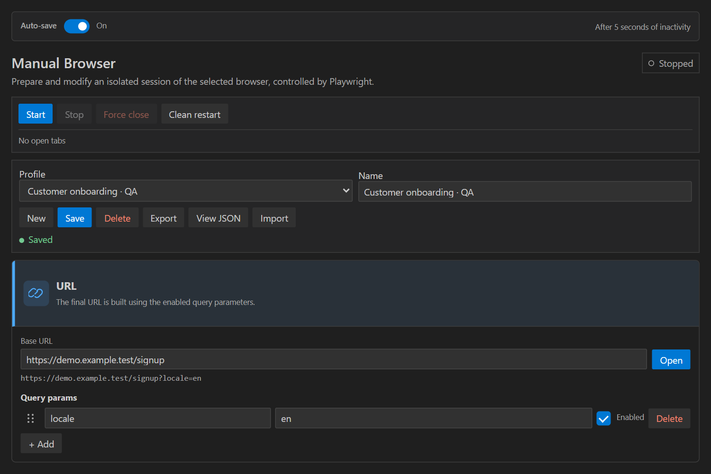
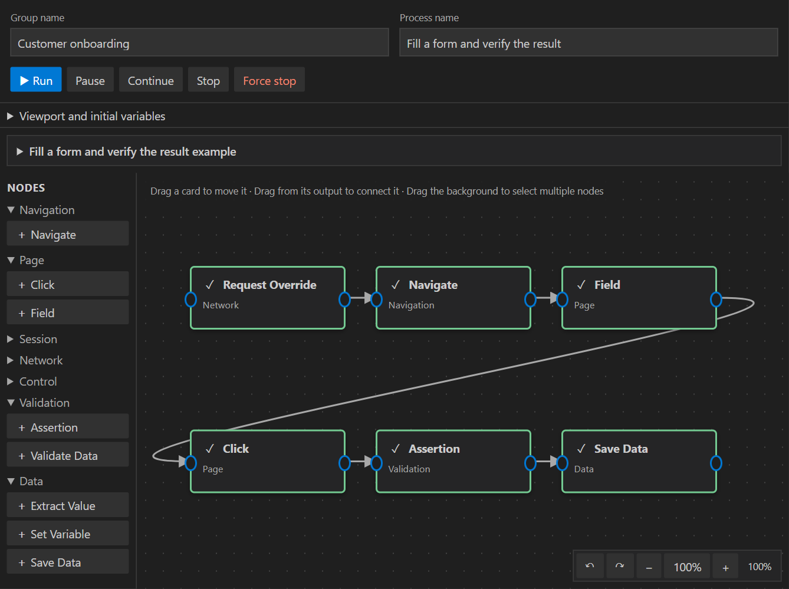
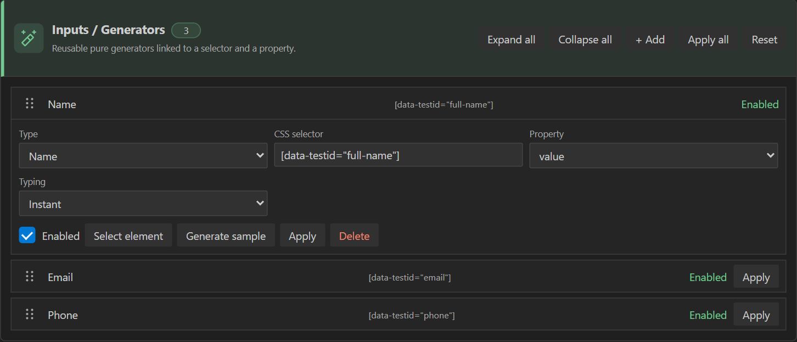

<p align="center">
  
</p>

<h1 align="center">Browser Control Center</h1>

<p align="center">
  <strong>Prepare test data, control your browser and automate web testing from VS Code.</strong>
</p>

<p align="center">
  <a href="https://marketplace.visualstudio.com/items?itemName=leviax.browser-control-center"><strong>Install from Marketplace</strong></a>
  ·
  <a href="https://github.com/Charly30000/browser-control-center">GitHub</a>
  ·
  <a href="https://github.com/Charly30000/browser-control-center/issues">Report an issue</a>
</p>

<p align="center"><a href="#english">English</a> · <a href="#espanol">Español</a></p>

---

<a id="english"></a>

Filling forms, preparing cookies, changing data and repeating the same journey can take longer than the test itself. **Browser Control Center** brings those tasks into your editor: prepare a session, generate data and save your setup for the next run.

Start with a manual test or connect steps in a visual flow. Use **your installed Chrome or Managed Chromium**, with sessions isolated from your personal browser.

<a id="screenshots"></a>

## See it in action

Prepare a reusable test session or run a connected flow. Green nodes show successfully completed steps.

<div align="center">
<table align="center">
  <tr>
    <th>Manual</th>
    <th>Automations</th>
  </tr>
  <tr>
    <td align="center"><a href="https://raw.githubusercontent.com/Charly30000/browser-control-center/HEAD/docs/screenshots/manual-session.png"></a></td>
    <td align="center"><a href="https://raw.githubusercontent.com/Charly30000/browser-control-center/HEAD/docs/screenshots/automations.png"></a></td>
  </tr>
  <tr>
    <td align="center"><a href="https://raw.githubusercontent.com/Charly30000/browser-control-center/HEAD/docs/screenshots/manual-session.png">Open full-size image ↗</a></td>
    <td align="center"><a href="https://raw.githubusercontent.com/Charly30000/browser-control-center/HEAD/docs/screenshots/automations.png">Open full-size image ↗</a></td>
  </tr>
</table>
<table align="center">
  <tr>
    <th>Inputs / Generators</th>
  </tr>
  <tr>
    <td align="center"><a href="https://raw.githubusercontent.com/Charly30000/browser-control-center/HEAD/docs/screenshots/manual-inputs.png"></a></td>
  </tr>
  <tr>
    <td align="center"><a href="https://raw.githubusercontent.com/Charly30000/browser-control-center/HEAD/docs/screenshots/manual-inputs.png">Open full-size image ↗</a></td>
  </tr>
</table>
</div>

## What you can do

- **Fill forms with test data.** Use fixed text, names, emails, phone numbers, numbers, Spanish DNI/NIE/CIF identifiers, or your own formulas and value lists.
- **Prepare the session you need.** Configure URLs, parameters, headers, cookies, localStorage and sessionStorage. Try desktop, mobile and tablet viewports.
- **Mock API responses.** Intercept requests to return JSON, modify data or reproduce errors without changing the server.
- **Build visual automations.** Connect navigation, fields, clicks, waits and checks. Organize journeys into reusable groups and processes.
- **Capture and reuse information.** Read fields, text or DOM attributes, extract JSON properties and store values in variables for later steps.
- **Share your work as JSON.** Import/export profiles, resources and automations, or edit them through **View JSON**.

## Five places to work

| Section | What it does |
| --- | --- |
| **Manual** | Prepare a session, pick page elements and apply values when you choose. |
| **Formulas** | Create reusable JavaScript generators with `function generate()`. |
| **Arrays** | Save JSON lists and randomly select values for your tests. |
| **Automations** | Design and run flows with nodes, variables and checks. |
| **AI Documentation** | Copy a usage guide into your AI chat to get help and generate JSON for your case. |

## Get started

1. **[Install Browser Control Center from the VS Code Marketplace](https://marketplace.visualstudio.com/items?itemName=leviax.browser-control-center).**
2. Open its sidebar icon and click **Manage browser**. Choose your installed Chrome or install Managed Chromium from that panel.
3. In **Manual**, prepare a profile, enter a URL and click **Open**. Add a field and use **Select element** to pick its target on the page.
4. Choose the data to enter and click **Apply**. Save the profile to reuse its configuration.

You can also install it from a terminal:

```sh
code --install-extension leviax.browser-control-center
```

You need **VS Code desktop 1.90 or later**. The browser is configured separately and is not included in the extension download.

Manual, Arrays, Formulas and Automations have an **Auto-save** switch at the very top. It is **enabled by default** and saves changes after **5 seconds without interacting with extension controls**. Moving the mouse or scrolling does not restart the wait. Saving does not run tests or browser actions. To disable Auto-save and retain that choice, turn it off and click **Save**.

## Test manually, then automate

### Manual: decide when to apply

Prepare values, generate samples and apply them to one field or all enabled fields. **Apply** stays accessible on collapsed rows. If a field fails, **Apply all** continues with the rest and reports the result.

Reorder items within each section using the dotted handles. This also works for cookies, storage and overrides, including each rule's headers. Use the mouse wheel while holding an item to scroll, or **Alt+↑/↓** on a focused handle to reorder with the keyboard.

Cookies, overrides and generators remember whether their rows are expanded, including in shared JSON. **Expand all** and **Collapse all** affect the rows in their own section.

Loading or editing a profile does not automatically fill forms. Assisted typing protects against accidental submissions while values are applied; you decide when to submit the website's form.

### Automations: connect the steps

Reorder groups and processes using their drag handles, move processes between groups and collapse groups you are not using. The automation document retains names, order and expansion, including in JSON.

Turn a repeated journey into a visual flow:

```text
Open page → Fill field → Save Data → Reuse variable → Check result
```

**Save Data** reads a DOM field or extracts a property such as `item.id` from JSON, then stores it in a variable. Use `{itemId}` in a later node.

To start without preparing a website, click **Add example** in Automations. Connected processes include a mocked page and API: **the examples need no external server or Internet access**. Some intentionally pause so you can inspect the browser and click **Continue**.

Each process runs in a clean session. Pause or stop a journey, or add a manual wait to complete a login, CAPTCHA or two-factor verification.

Use **Remove Headers**, **Remove Cookies** and **Remove Storage** to delete selected session data or clear the chosen scope. Checks support **contains** and negative variants, including **does not contain** and **does not exist**. **Add example** includes offline flows demonstrating each removal mode and validation option.

For selected removal, click **Add** for each name or key and enter it in its own input. Each row has a **Delete** button to remove it from the configuration.

## Ask your AI and paste the result

The fifth sidebar button, **AI Documentation**, collects usage instructions, options and the application's accepted JSON formats.

1. Open it and click **Copy documentation**.
2. Paste it into your chat and describe your goal. To modify an existing item, also include its **View JSON** document.
3. Ask for a complete JSON document for the profile, resource or flow.
4. Paste it into **View JSON**, click **Apply changes**, review it and then **Save**.

You can also save the document as a file and **Import** it. For Formulas, request code for the Code editor; for Arrays, request a JSON list. Selectors must match your page, and referenced resources must exist in your catalog.

## Keep the setup, start with a clean session

Saved profiles, formulas, arrays and automations remain available for reuse and across extension updates. Export them to share your work or move to another installation; Manual profiles include the formulas and arrays they reference.

Supported older documents are upgraded automatically when opened or imported. Selectors show saved items whose files still exist; if one is missing, import a backup rather than changing version numbers or inventing resource IDs. See [troubleshooting](docs/troubleshooting.md) for recovery steps.

Browser sessions are separate from your personal profile and are discarded when closed. Formulas are tested in an isolated browser, without network access, with a two-second execution limit.

If an action fails, check **Output → Browser Automation** for details.

## Guides and community

The interface and in-app AI documentation are in English. Most repository guides below are currently in Spanish.

- **Usage:** [Manual](docs/manual-page.md), [Automations](docs/automations-page.md), [Formulas](docs/formulas.md) and [Arrays](docs/arrays-page.md).
- **Setup and data:** [browsers](docs/browser-runtime.md), [import/export](docs/import-export.md) and [troubleshooting](docs/troubleshooting.md).
- **Development:** [development guide](docs/development.md), [architecture](docs/architecture.md), [tests](docs/testing.md) and [text catalog](docs/localization.md).
- **Project:** [GitHub repository](https://github.com/Charly30000/browser-control-center), [changelog](CHANGELOG.md) and [issues or ideas](https://github.com/Charly30000/browser-control-center/issues).

Found a bug or have an idea to improve your tests? [Tell us on GitHub](https://github.com/Charly30000/browser-control-center/issues).

## License

Copyright 2026 Andres Manuel Armesto Fernández. Distributed under the [Apache License 2.0](LICENSE). Dependency licenses and attributions are listed in [THIRD_PARTY_NOTICES.md](THIRD_PARTY_NOTICES.md).

---

<a id="espanol"></a>

## Español

**Prepara datos, controla el navegador y automatiza tus pruebas web desde VS Code.**

La interfaz está en inglés; los nombres de botones que aparecen a continuación coinciden con los que verás en la extensión.

Rellenar formularios, preparar cookies, cambiar datos y repetir el mismo recorrido puede ocupar más tiempo que la propia prueba. **Browser Control Center** reúne esas tareas en un panel dentro de tu editor: prepara una sesión, genera datos y guarda lo que necesitas para volver a utilizarlo.

Empieza con una prueba manual o conecta los pasos en un flujo visual. Puedes trabajar con **Chrome instalado o Chromium administrado**, en sesiones aisladas de tu navegador personal.

**[Mira cómo se ve la extensión](#screenshots):** Manual reúne la configuración y los datos de prueba; Automatizaciones muestra un flujo con seis nodos conectados y completados en verde. Cada captura tiene un enlace **Open full-size image** para abrir la imagen original en el navegador. También puedes ver el [detalle de Inputs / Generators ↗](https://raw.githubusercontent.com/Charly30000/browser-control-center/HEAD/docs/screenshots/manual-inputs.png).

## Lo que puedes hacer

- **Rellenar formularios con datos de prueba.** Usa texto fijo, nombres, emails, teléfonos, números, DNI, NIE o CIF, además de tus propias fórmulas y listas de valores.
- **Preparar la sesión que necesitas.** Configura URL, parámetros, headers, cookies, localStorage y sessionStorage. Prueba distintos tamaños de pantalla, incluidos móvil y tablet.
- **Simular respuestas de una API.** Intercepta peticiones para devolver un JSON, modificar datos o reproducir errores sin cambiar el servidor.
- **Crear automatizaciones visuales.** Conecta navegación, campos, clicks, esperas y comprobaciones. Organiza tus recorridos en grupos y procesos reutilizables.
- **Capturar y reutilizar información.** Lee campos, texto o atributos del DOM, extrae propiedades JSON y guarda valores en variables para los siguientes pasos.
- **Compartir tu trabajo en JSON.** Importa y exporta perfiles, recursos y automatizaciones, o edítalos desde **View JSON**.

## Cinco espacios para tu trabajo

| Sección | Para qué sirve |
| --- | --- |
| **Manual** | Preparar una sesión, elegir elementos de la página y aplicar valores cuando tú decidas. |
| **Formulas** | Crear generadores JavaScript reutilizables con `function generate()`. |
| **Arrays** | Guardar listas JSON y escoger valores aleatorios para tus pruebas. |
| **Automations** | Diseñar y ejecutar flujos con nodos, variables y comprobaciones. |
| **AI Documentation** | Copiar una guía de la aplicación para pedir ayuda y generar JSON adaptado a tu caso. |

## Empieza en unos pasos

1. **[Instala Browser Control Center desde la tienda de VS Code](https://marketplace.visualstudio.com/items?itemName=leviax.browser-control-center).**
2. Abre su icono en la barra lateral y pulsa **Manage browser**. Selecciona tu Chrome instalado o instala Chromium administrado desde ese panel.
3. En **Manual**, prepara un perfil, indica la URL y pulsa **Open**. Añade un campo y utiliza **Select element** para elegir su destino en la página.
4. Elige el dato que quieres introducir y pulsa **Apply**. Guarda el perfil para reutilizar su configuración.

También puedes instalarla desde la terminal:

```sh
code --install-extension leviax.browser-control-center
```

Necesitas **VS Code de escritorio 1.90 o superior**. El navegador se configura por separado: no viene incluido en la descarga de la extensión.

Manual, Arrays, Fórmulas y Automatizaciones incluyen el interruptor **Auto-save** arriba del todo. Está **activado por defecto** y guarda tras **5 segundos sin interactuar con controles**, sin ejecutar pruebas ni acciones del navegador. Mover el ratón o hacer scroll no reinicia la espera. Para conservar su desactivación, apágalo y pulsa **Save**.

## Prueba primero, automatiza después

### Manual: tú decides cuándo aplicar

Prepara valores, genera muestras y aplícalos a un campo o a todos los campos activos. **Apply** sigue accesible cuando minimizas una fila. Si un campo falla, **Apply all** continúa con los demás y te indica qué ha ocurrido.

Organiza las filas de cada grupo arrastrándolas desde su asa de puntos y guarda el perfil para conservar el orden. Funciona también en cookies, storages y overrides, incluidos los headers de cada regla.

Conserva qué cookies, overrides y generadores tienes expandidos, también al compartir su JSON. **Auto-save** guarda los cambios tras **5 segundos sin actividad**; puedes desactivarlo y usar **Save** cuando prefieras.

Cargar o editar un perfil no rellena automáticamente los formularios. La escritura asistida protege frente a envíos accidentales durante la aplicación; tú decides cuándo enviar el formulario de la página.

### Automatizaciones: conecta los pasos

Ordena grupos y procesos desde sus asas de arrastre, mueve procesos entre grupos y pliega los grupos que no estés usando. El documento de automatizaciones conserva el orden y el estado expandido, también en su JSON.

Convierte un recorrido repetido en un flujo visual. Por ejemplo:

```text
Abrir página → Rellenar campo → Guardar dato → Reutilizar variable → Comprobar resultado
```

El nodo **Save Data** permite leer un campo o extraer una propiedad como `item.id` de un JSON y guardarla en una variable. Después puedes utilizar `{itemId}` en otro nodo.

Para empezar sin preparar una web, pulsa **Add example** en Automatizaciones. Encontrarás procesos ya conectados con una página y una API simuladas: **los ejemplos no necesitan un servidor externo ni acceso a Internet**. Algunos incluyen una pausa para que puedas inspeccionar el navegador y pulsar **Continue**.

Cada proceso se ejecuta en una sesión limpia. Puedes pausar el recorrido, detenerlo o añadir una espera para completar manualmente un login, un CAPTCHA o una verificación en dos pasos.

Usa **Remove Headers**, **Remove Cookies** y **Remove Storage** para eliminar datos concretos de la sesión o limpiar el ámbito elegido. Las comprobaciones admiten **contains** y variantes negativas como **does not contain** y **does not exist**. **Add example** incluye procesos sin conexión que demuestran cada modo de eliminación y cada opción de validación.

Para eliminar elementos concretos, pulsa **Add** por cada nombre o clave y escríbelo en su propio input. Cada fila tiene un botón **Delete** para quitarla de la configuración.

## Pide ayuda a tu IA y pega el resultado

El quinto botón lateral, **AI Documentation**, reúne las instrucciones de uso, las opciones y los formatos JSON que acepta la aplicación.

1. Abre esa página y pulsa **Copy documentation**.
2. Pégala en tu chat y describe qué quieres preparar. Si vas a modificar algo existente, añade también su documento de **View JSON**.
3. Pide el documento JSON completo para el perfil, recurso o flujo que necesitas.
4. Pégalo en **View JSON**, pulsa **Apply changes**, revisa el resultado y después **Save**.

También puedes guardar el documento en un archivo e **Import**. En Fórmulas puedes pedir solo el código para su editor; en Arrays, solo la lista JSON. Los selectores deben corresponder a tu página y las referencias a recursos deben existir en tu catálogo.

## Guarda la configuración, empieza con una sesión limpia

Los perfiles, fórmulas, arrays y automatizaciones guardados quedan disponibles para reutilizarlos. Exportarlos te permite compartirlos o llevarlos a otra instalación; los perfiles Manual incluyen las fórmulas y arrays que utilizan.

Los documentos antiguos compatibles se actualizan automáticamente al abrirlos o importarlos. Los selectores muestran elementos guardados cuyo archivo existe; si falta alguno, importa una copia de seguridad en lugar de cambiar versiones o inventar IDs. Consulta [resolución de problemas](docs/troubleshooting.md) para recuperarlos.

Las sesiones de navegador son independientes de tu perfil personal y no se conservan al cerrarlas. Las fórmulas se prueban en un navegador aislado, sin red y con un límite de ejecución de dos segundos.

Si una acción falla, consulta **Output → Browser Automation** para ver el detalle.

## Guías y comunidad

- **Uso:** [Manual](docs/manual-page.md), [Automatizaciones](docs/automations-page.md), [Fórmulas](docs/formulas.md) y [Arrays](docs/arrays-page.md).
- **Configuración y datos:** [navegadores](docs/browser-runtime.md), [importación y exportación](docs/import-export.md) y [resolución de problemas](docs/troubleshooting.md).
- **Desarrollo:** [guía de desarrollo](docs/development.md), [arquitectura](docs/architecture.md) y [pruebas](docs/testing.md).
- **Proyecto:** [repositorio en GitHub](https://github.com/Charly30000/browser-control-center), [novedades](CHANGELOG.md) y [errores o propuestas](https://github.com/Charly30000/browser-control-center/issues).

¿Has encontrado un fallo o tienes una idea para mejorar tus pruebas? [Cuéntalo en GitHub](https://github.com/Charly30000/browser-control-center/issues).

## Licencia

Copyright 2026 Andres Manuel Armesto Fernández. Distribuido bajo [Apache License 2.0](LICENSE). Consulta las licencias y atribuciones de las dependencias en [THIRD_PARTY_NOTICES.md](THIRD_PARTY_NOTICES.md).
